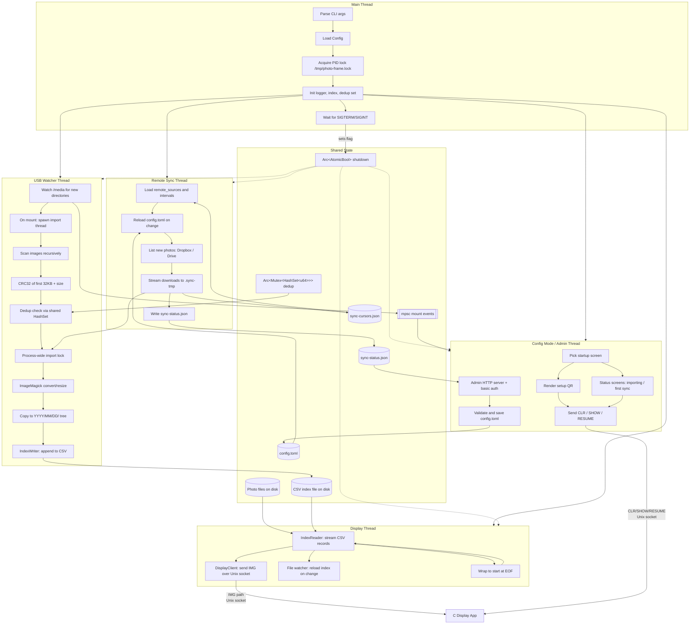

# Digital Photo Frame

This is a small Rust program that runs a photo slideshow on a Raspberry Pi Zero 2 W. It pairs with a tiny C graphics app that actually draws the pictures to the screen. No desktop environment needed. It talks to the GPU directly.

## What it does

The Rust side runs four worker threads in the background:

Photo display reads a CSV list of photos and sends paths to the C app over a Unix socket. The C app loads each image, fades it in, and shows it for a while. The socket naturally paces things: if the C app is busy, the Rust side blocks until it can send the next photo.

USB import watches `/media` for USB drives. When you plug one in, it scans for JPEGs and HEICs, checks if you already have them (using a quick hash), converts them to your screen's resolution, and copies them into a `YYYY/MM/DD` folder tree.

Remote sync pulls photos from Dropbox or Google Drive on a schedule. It pages through the remote folder, downloads new files into a temporary directory on the photo partition, and runs them through the same dedup and conversion pipeline as a USB import. Dropbox uses its own opaque cursor and bearer-auth Google Drive sources use the Changes API, so each run only looks at what changed; API-key Drive sources and legacy cursors fall back to a timestamp. It reports per-source status to the admin UI.

Config mode is the setup UI. When the frame has no photos and no remote sources, or after you insert a USB drive, it shows a QR code on screen and starts a small web server. Scan the code with a phone to add or edit remote sources. Changes are staged in memory and written to `config.toml` only when you press **Finish**.

Storage cleanup kicks in automatically if the photo partition fills up. It deletes the oldest batch of photos to make room, whether the write that ran out of space was a USB import or a remote download.

## Private Google Drive

For a private Drive folder, the frame uses a **service account**: you create one in your own Google Cloud project, share the folder with its synthetic email address as Viewer, and paste the JSON key into the admin UI. See [docs/google-drive-setup.md](docs/google-drive-setup.md) for the steps. A service account cannot own files, so create the folder with your normal Google account and share it. Public folders can use an API key instead.

A web OAuth callback and the device flow are not supported: the admin UI is plain HTTP, and Google's device flow cannot read an existing folder. HTTPS for the admin UI is future work (see [plans/SYNC_SOURCES.md](plans/SYNC_SOURCES.md)).

## Where it runs

- Raspberry Pi Zero 2 W is the main target. The C app uses the VideoCore GPU for OpenGL ES rendering.
- Debian VM (UTM/QEMU) works too. GPU acceleration helps; without it, Mesa falls back to CPU rendering (llvmpipe) and fades get choppy.
- Other Linux boards probably work if they have DRM/GBM/EGL support and a Mesa driver. Hardware acceleration helps a lot at 1080p.

## Updates

Application updates use signed release bundles and `photo-frame-update`. The
`.deb` seeds the first release under `/opt/photo-frame/releases`; later releases
are verified against Ed25519 keys compiled into the updater, unpacked into a new
release directory, and activated by flipping a `current` symlink. A health check
waits 30 seconds for both services and both sockets, and
`photo-frame-update-guard.service` confirms or rolls back an unconfirmed release
on the next boot. The OS is not part of a bundle: Debian security fixes come from
`unattended-upgrades`, and the kernel and firmware are updated by hand about
twice a year over a VPN.

CI builds the `.deb` packages and the arm64 update bundle, and opens the draft
release. Signing is still a manual, protected GitHub Actions workflow. See
[docs/updates.md](docs/updates.md) for the bundle layout, commands, signing and
key rotation, the release process, the remote access policy, and recovery
procedures.

## How it fits together



**Thread breakdown:**

1. The main thread parses args, loads the TOML config, grabs a PID lock (`/tmp/photo-frame.lock`), sets up logging, the photo index, and the dedup set, then starts the four worker threads. It sits waiting for `SIGTERM` or `SIGINT`. When it gets one, it flips a shutdown flag and exits after 200ms. It doesn't wait for workers to finish, since they might be stuck in I/O. The OS cleans up.

2. The display thread opens the CSV index and loops through records one by one. For each photo, it sends `IMG <path>\n` over the Unix socket. The write blocks if the C app's buffer is full, so the slideshow naturally stays in sync with the screen. At EOF, it wraps back to the start. If the index file gets rewritten (e.g., after a USB import), an inotify watcher notices and the reader reopens it. The first photo is picked at random so you don't always start with the same one.

3. The USB watcher thread watches `/media` for new directories, and also rescans every couple of seconds so drives mounted before startup or by hand are not missed. When a drive mounts, it spawns a thread to handle the import. That thread recursively scans for images, hashes the first 32KB plus file size, checks against the shared dedup set, runs ImageMagick to resize, copies the result into `photos_dir/YYYY/MM/DD/`, and appends a line to the CSV. If the disk is full, it triggers rotation (deletes oldest photos) and retries. A process-wide import lock keeps USB and remote imports from stepping on the index.

4. The remote sync thread wakes on each source's `check_interval_seconds`, reloads `config.toml` when it changes, and lists new photos. Dropbox uses its opaque `files/list_folder` cursor (`dbx:`) and authenticates with either a static access token or a refresh-token set (`refresh_token` + `app_key` + `app_secret`); bearer-auth Google Drive sources use the Changes API (`gdrive:`). API-key Drive sources and legacy cursors keep a timestamp. Downloads stream into `photos_dir/.sync-tmp/` and then go through the normal import pipeline. A download that hits `ENOSPC` rotates the oldest photos and retries. Transient HTTP errors are retried with backoff. If a download fails, the cursor stays put so the batch is retried instead of skipped. Cursors live in `sync-cursors.json`, and status goes to `sync-status.json`; `last_sync` records the last successful sync, is reloaded at startup, and schedules sources whose cursor is opaque.

5. The config mode thread decides what the screen should show: slideshow, "Importing photos...", "First remote sync in progress", or the setup QR. In setup it starts the admin server, renders the QR and status screens, and sends `CLR`/`SHOW`/`RESUME` over the control socket. It stages changes in memory, validates them on **Finish**, and atomically rewrites `config.toml`. Removing the USB drive or hitting the 10-minute idle timeout discards the session without writing anything.

Some design choices that might matter:

- Everything is synchronous. We use `std::thread` for concurrency and plain blocking I/O. This keeps dependencies small and avoids pulling in tokio.
- The display app doesn't respond to protocol messages. Backpressure is just the kernel socket buffer. When it's full, the Rust side blocks. That is the whole mechanism.
- Deleted entries stay in the CSV file as ghosts. The filename tracks the valid range (`index-<start>-<count>.csv`). When ghosts exceed 50%, the file gets rewritten.
- Remote cursors are opaque provider cursors: `dbx:` for Dropbox and `gdrive:` for bearer-auth Google Drive. API-key Drive sources and legacy cursors keep a Unix timestamp, with a 2-second overlap so a file changed in the same second as the last cursor is not missed.
- Config mode is plain HTTP with a rotating 8-character password and HTTP Basic Auth. There are no unauthenticated admin routes. HTTPS is future work.
- Logs go to `/tmp` (tmpfs), so there is no SD card wear from logging. The photo partition uses `noatime,lazytime`.

## The C display app

The C app (`c/photo-frame-display.c`) handles all the graphics. It opens a DRM device directly, with no X11 or Wayland involved. GBM allocates framebuffers, EGL sets up an OpenGL ES 2.0 context, and images are loaded with stb_image and drawn as textured quads. Fade transitions are just alpha blending between two textures. A second Unix socket accepts `CLR`, `SHOW`, and `RESUME` so config mode can pause the slideshow and hold a setup or status screen.

## Project Structure

The rough structure of the project is this.

```
photo-frame/
├── c/            # C display app source code
├── demos/        # Original demo/PoC code, kept for historical purposes
├── docs/         # User and developer documentation
├── plans/        # Living spec, sync-source plan, and design notes
├── src/          # Rust manager source code
│   └── import/   # USB + Dropbox/Google Drive import pipeline
├── templates/    # Admin UI templates
├── tests/        # Rust integration tests
├── Makefile      # builds everything
```

## Reference Documentation

- [plans/SPEC.md](plans/SPEC.md) — Living specification: what features exist and how they operate.
- [plans/SYNC_SOURCES.md](plans/SYNC_SOURCES.md) — Remote sync design, admin UI, and future work.
- [docs/building.md](docs/building.md) — Build instructions and Makefile options.
- [docs/running.md](docs/running.md) — How to run the apps locally.
- [docs/config.md](docs/config.md) — Configuration reference.
- [docs/deployment.md](docs/deployment.md) — DietPi setup, packaging, and installation.
- [docs/updates.md](docs/updates.md) — Signed update bundles, signing keys, rotation, and OS/kernel policy.
- [docs/google-drive-setup.md](docs/google-drive-setup.md) — Private Drive setup with a service account.
- [docs/testing.md](docs/testing.md) — Test commands and methodology.

## License

This project is licensed under the [GNU Affero General Public License v3.0](LICENSE) or later.
